# Ark 1P Hub

**Solo arcade games** for your living room. The TV shows the game and your
**phone is the controller**: scan a QR code and play in the browser, nothing to
install. No phone handy? A game controller plugged into the TV, or the TV's
keyboard, works too. Every run is scored, and the hub keeps your **best** and a
**high-score table** for everyone who plays. Self-hosted in a single Docker
container on your home network.

It's the one-player sibling of [Ark 2P Hub](https://github.com/areyesromo/Ark-2P-Hub)
(1v1 party games), built the same way. See [docs/PLAN.md](docs/PLAN.md) for the plan.

<p align="center">
  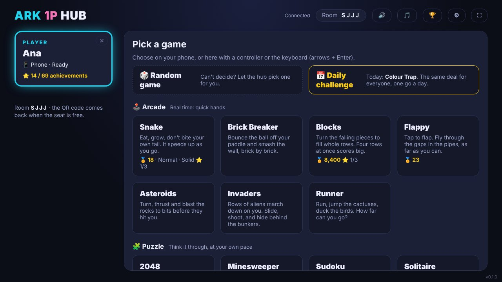
  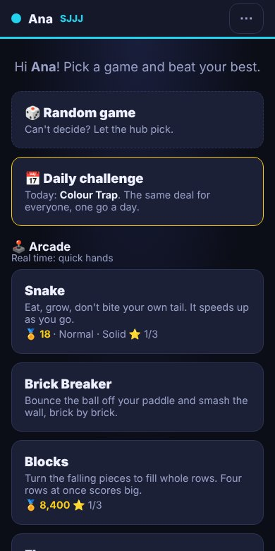
</p>


## Games

Once someone has taken the seat, the lobby on the TV puts the player in a narrow column on the left and gives the
rest of the screen to the games (the QR code comes back when the seat is free). It groups them into **🕹️ Arcade** (real time, quick hands),
**🧩 Puzzle** (think it through, at your own pace) and **🧠 Brain** (memory and
reflexes). Each card shows your best, and **🎲 Random game** at the top picks one
for you (never the one you just played). Up and down on a controller (or the arrow keys) go to the card
above or below; left and right go through them in order. During a game the top of the TV shows
the best to beat; at the end the hub shows your score, whether it's a
**🎉 New best!** and where it ranks on this hub, then **Play again**, change
the settings, or pick another game.

### 🕹️ Arcade

| Game | How it plays |
| --- | --- |
| **Snake** | The classic: eat the glowing food to grow, don't hit a wall or your own tail. Every 4 bites the snake speeds up. Tap a side of the phone pad or swipe to turn (turns can be chained in one swipe). Before you start, pick the speed (Normal or ⚡ Fast) and the walls (🧱 Solid, or 🌀 Wrap round: come out on the other side). ⏸ Pause on the phone (or Start on a controller). Snakes to unlock (just for looks): 🌈 Rainbow (eat 10), 💜 Neon (25) and 👑 Gold (50). Score: food eaten; each speed and wall setting keeps its own bests. |
| **Brick Breaker** | Keep the ball in play with your paddle and smash the wall. Slide a finger along the phone's strip to move the paddle (or the stick / D-pad). Where the ball hits the paddle sets its angle, and it speeds up a little on every hit. Higher rows score more (1, 3, 5, 7 points). Clear the wall for a new, faster level with a different pattern (and a life back); lose the ball 3 times and it's over. 🚀 Launch on the phone, or it goes by itself after 3 s. Pick 3 lives or 5 (easy, with its own scores). Ball and paddle styles to unlock (just for looks): 🔥 Fireball (clear a wall), 💎 Crystal (reach level 4) and 🌈 Rainbow (score 1,000). |
| **Blocks** | The falling-block classic: pieces of four squares drop into a 10×20 well. Move and turn them so they fill whole rows, which clear. Every 10 rows the level goes up and pieces fall faster. Clearing several rows at once scores far more (100, 300, 500 or 800 points for 1 to 4 rows, times the level), plus a point a row when you drop a piece yourself. **Hold** puts a piece aside for later (once per piece); the TV shows it, the next three pieces and a shadow where yours will land. On the phone: ◀ ▶ move (hold to repeat), ⟲ ⟳ turn, ▼ soft drop, **⤓ Drop** drops it at once. Pieces come in shuffled sets of seven, so you never wait long for a straight piece. The run ends when a new piece has no room. |
| **Flappy** | Tap the phone's big button to flap; the bird falls the rest of the time. Fly through the gaps between the pipes without touching them or the ground (the top just stops you). The pipes come a little faster and the gaps get a little smaller as you go. The first tap starts the run. Fly as something else (just for looks): a 🦇 Bat (10 pipes), a 🐧 Penguin (25) or a 🐉 Dragon (50). Score: pipes passed. |
| **Asteroids** | Turn your ship, thrust and shoot. Big rocks split in two when you hit them, middle ones split again, small ones are gone; everything wraps round the edges of the screen. A rock that hits you costs a ship (3 to start, you come back in the middle and blink, safe, for a moment). Clear the screen and a bigger wave comes. On the phone: hold ⟲ ⟳ to turn and 🔥 Thrust to fly, tap 💥 Fire (a few shots at a time). Ships to unlock (just for looks): a 🚀 Rocket (wave 3), a 🛸 Saucer (wave 6) and ✨ Gold (score 10,000). Score: 20 for a big rock, 50 a middle one, 100 a small one; an extra ship every 10,000. |
| **Invaders** | Rows of aliens march side to side, step down at each edge and drop bombs: slide your cannon along the bottom and shoot them all before they land. One shot on screen at a time. Four bunkers give cover, and get chewed away by shots from both sides. The fewer aliens left, the faster they march; now and then a saucer flies across the top for a bonus. Clear a wave and the next starts a little lower. On the phone: slide a finger along the strip to move, tap 🔫 Fire. 3 lives. Invaders to unlock (just for looks): 🐙 Ocean (clear a wave), 👻 Spooky (shoot a saucer) and 🍭 Candy (score 5,000). Score: 10 to 30 an alien (the top rows are worth more), 50 to 300 a saucer. |
| **Runner** | You run on and on: jump the cactuses (one to three together, short or tall) and duck under the birds (low ones you can jump, high ones fly over you). Hold JUMP for a higher jump. The run gets faster the further you go. Your first jump starts it. Run as someone else (just for looks): a 🤖 Robot (100 m), a 🦖 Dino (500 m) or a 🥷 Ninja (1,000 m). Score: how far you got, in metres. |
| **Stack** | A block slides back and forth above the tower: tap (the phone's big DROP button) to drop it. The part hanging over the edge is cut off and falls away, so the blocks get narrower; drop it right on top for a **Perfect!** and nothing is lost, and every third perfect drop in a row wins a little width back. Miss the tower and it's over. It speeds up as the tower grows. Block styles to unlock (just for looks): 🍬 Candy (10 blocks), 🧊 Glass (25) and 👑 Gold (5 perfect drops in a row). Score: blocks stacked. |
| **Helicopter Cave** | Hold the phone's big CLIMB button to rise, let go to drop, and fly down a winding cave without touching the walls. The cave gets narrower and faster the further you go, and after a while rocks stick out of the ceiling and the floor. The first hold takes off. Four maps, each with its own scores: the 💎 Crystal Cave, then the ⛏️ Old Mine (wooden props everywhere, unlocked by flying 100 m), the 🧊 Ice Tunnel (twistier, icicles; 300 m in the mine) and the 🌋 Volcano (faster; 300 m on the ice). Flying far also unlocks new things to fly (just for looks): a Jet (500 m), a UFO (300 m in the Volcano) and a Dragon (1,000 m). Locked choices show on the setup screen with what opens them. Score: metres flown. |
| **Bubble Shooter** | Coloured bubbles hang from the ceiling. Drag on the phone to aim the launcher (the TV shows the line, bouncing off the walls) and let go to fire: the bubble sticks where it touches, three or more of a colour together pop, and anything left hanging from nothing falls (worth double). Five shots in a row that pop nothing and the whole ceiling comes down a row; a bubble on the red line at the bottom ends it. Clear the board for 1,000 and a new one with another colour. Score: points. |
| **Road Hopper** | Get the frog to the far bank: hop across five lanes of traffic (cars and trucks, each lane its own speed), rest on the verge, then cross the river on the logs. Cars squash you, the water's deadly, and a log carries you along, off the edge if you stay on too long. Tap the phone's arrows or swipe. Three frogs, and 30 seconds for each go. Every crossing scores 50 plus 2 for each second left, and the next crossing is faster; each row further than before is 10. Score: points. |

### 🧩 Puzzle

| Game | How it plays |
| --- | --- |
| **2048** | Swipe on the phone (or tap a side of the pad) to slide every tile on the 4×4 board; two equal tiles that bump into each other merge into their sum, which is added to your score. A new 2 (sometimes a 4) appears after every move. Make a 2048 tile and keep going; the run ends when nothing can move (or tap **End this run** twice). |
| **Minesweeper** | Open every cell that isn't a mine. A number counts the mines in the 8 cells around it. Tap to dig, hold to flag (or switch the phone to 🚩 flag mode); tapping a number whose mines are all flagged opens the rest around it. The first cell you open is always safe. Three fields: Easy 9×9 (10 mines), Medium 16×16 (40), Hard 30×16 (99, shown turned on an upright phone). Score: your time, only when you clear the field; lower is better, and each field has its own bests. |
| **Sudoku** | Fill the 9×9 grid so every row, column and 3×3 box has 1 to 9 once each. Tap a cell on the phone, then a number; ✏️ Pencil switches to small notes (a number you place rubs out the same note around it), ⌫ clears. The picked cell, its row, column and box, and the same number elsewhere are shaded on the TV and the phone; two of the same number in a line or box turn red (that only says they can't both be right, not which is wrong). Every puzzle is made fresh with exactly one solution: Easy (40 numbers given), Medium (32) or Hard (26). Pausing hides the grid. Score: your time, per difficulty. |
| **Solitaire** | Klondike: build the four foundations up by suit from ace to king. In the seven columns cards go down in alternating colours, a face-up run moves together, and only a king goes into an empty column. Tap the stock to turn cards over (one at a time, or three: pick on the setup screen, each has its own scores); when it runs out it turns back over. **Tap a card and it goes where it fits** (home first). If it can't go anywhere it's picked up: tap where it should go. Undo as often as you like. Once every card is face up, ✨ Finish sends them all home. Score: your time; a game you give up on doesn't count. |
| **FreeCell** | All 52 cards dealt face up into eight columns, plus four **free cells** that each hold one card for a while. Build the foundations up by suit from ace to king; in the columns cards go down in alternating colours, and any card can go into an empty column. A run of cards moves together if there's room to do it one card at a time (free cells + 1, doubled for each empty column). **Tap a card and it goes where it fits** (home, a column, then a free cell); if it can't, it's picked up and the next tap puts it down. Undo as often as you like; ✨ Finish sends everything home once every column is in order. Nearly every deal can be won. Score: your time; a game you give up on doesn't count. |
| **Mahjong Solitaire** | A pile of 76 tiles in four layers: take away matching pairs until it's gone. A tile can be taken when nothing lies on top of it and its left or right side is open (those are bright; the others a little dimmer). Every deal can be cleared, since it's dealt by playing the game backwards. Stuck? **Undo**, or **🔀 Shuffle** what's left (+30 s); **💡 Hint** lights up a pair (+15 s). Score: your time; giving up doesn't count. |
| **Sliding Puzzle** | Numbered tiles in a square with one gap: slide them back into order, 1, 2, 3… with the gap at the bottom right. Tap a tile in line with the gap to slide it (and any tiles between) over, or swipe. Every shuffle is made of real slides, so it can always be solved. 3×3, 4×4 or 5×5. The clock starts with your first slide. Score: your time, per size. |
| **Gem Swap** | Swap two touching gems to line up three or more of a colour: they vanish, the gems above fall and new ones drop in, and any new lines vanish too (a chain, each step scoring more). A swap that makes no line doesn't happen. Swipe a gem into its neighbour, or tap one then the other. 30 swaps; a board with no moves left is reshuffled. Score: 10 a gem, +50 for a line of four, +150 for five, times the chain step. |
| **Sokoban** | You're the warehouse worker: push every box onto a target (a box on one turns green). You can only push, one box at a time, never pull, so a box shoved into a corner is stuck: ↶ **Undo** or ↺ **Start again**. Ten levels, from one box to seven, each opened by solving the one before (the setup screen shows which are open), each with a par: the fewest moves it can be done in. Walk with the phone's arrows or swipe on the board. Score: the moves it took (fewer is better), per level. |
| **Nonograms** | Picture logic: the numbers by each row and column are the runs of filled squares in that line, in order ("3 1" means three filled, a gap, then one). Fill squares until every line matches and the picture appears. On the phone tap a square, or drag across several, to fill them; switch to ✕ **Cross out** to mark squares you know are empty. A line whose filled squares match its numbers turns grey. Every puzzle is a fresh random picture that can be solved one line at a time, without guessing. 5×5, 10×10 or 15×15. Pausing hides the grid. Score: your time, per size. |
| **KenKen** | Fill the grid so each row and column has every number once (1 to 4 on a 4 × 4, up to 6). The heavy outlines are cages: each cage's numbers make its target with its sign (add them, multiply them, or for two squares the difference or the division, bigger first); a one-square cage just gives its number. Tap a square on the phone, then a number; clashes show in red. Every puzzle is new and has exactly one answer. 4 × 4, 5 × 5 or 6 × 6. Score: your time, per size. |
| **Lights Out** | A 5 × 5 grid of lights, some on. Tap a light to flip it and the four next to it (on goes off, off goes on): switch them all off. Every puzzle is made by flipping lights on a dark board, so it can always be solved, and par is how many flips made it. ↺ **Start again** puts the board back (the moves keep counting). Easy (par 4), Medium (8) or Hard (13). Score: the moves it took (fewer is better), per level. |
| **Word Search** | Words are hidden in a grid of letters in straight lines: drag on the phone from a word's first letter to its last (or tap both) to mark it. The list says which words to find and crosses them off. 8 × 8 hides 6 words across and down, 10 × 10 hides 8 with diagonals too, and 12 × 12 hides 10 any way at all, even backwards. Score: your time to find them all, per size. |

### 🧠 Brain

| Game | How it plays |
| --- | --- |
| **Simon** | The TV lights the four pads (each with its own note) in a sequence; tap them back in the same order on your phone's four big pads. Every round adds one more and plays a little faster. One wrong pad, or 5 s without a press, and it's over. Score: the longest sequence you repeated. |
| **Memory Pairs** | The cards lie face down: turn two over. A pair stays face up; two different ones turn back after a moment, so remember where they were. Find every pair in as few tries as you can: 4 × 4 (8 pairs), 6 × 4 (12) or 6 × 6 (18). Score: the tries it took (fewer is better), per size. |
| **Word Guess** | Find the hidden five-letter word in six guesses, typed on the phone's keyboard. After each guess the letters turn green (right place), yellow (in the word, elsewhere) or grey (not in it), and so do the keyboard's keys. Guesses must be real words (about 12,500 are allowed). 📅 **Today's word** is the same for everyone and can be played once a day (a new one at midnight UTC; a second go shows how you did); 🎲 **Practice** gives a new word every time. Score: the guesses it took; a word you don't find doesn't count. |
| **Reaction Rush** | The screen says **Wait…** (red), then after a random moment **TAP!** (green): hit the phone's big button as fast as you can. Five rounds. Tap before green and it's a false start: that round starts again and 100 ms goes on your time. Score: your average time plus penalties, in ms (lower is better). No music, so you can concentrate. |
| **Quick Maths** | Sums against the clock: pick the right answer of four on the phone's big buttons. They start easy (adding small numbers) and get harder every 5 right answers: taking away, times tables, then a mix with dividing and bigger numbers. 60 seconds; a wrong answer costs 3 of them. Score: right answers. |
| **Colour Trap** | A colour's name shows up written in another colour: tap the colour of the **ink**, not what the word says (BLUE written in red is red). Your brain wants to read the word; that's the trap. 45 seconds; a wrong answer costs 3 of them. Score: right answers. |
| **Anagram Rush** | Five mixed-up letters: tap them in order to make a word that uses all five, and it goes off by itself once the last letter's in (⌫ takes one back). Any real word counts, not only the one they came from. 60 seconds; ⏭ **Skip** shows the word but costs 3 seconds. Score: words made. |
| **Number Memory** | A number shows on the TV for a moment (longer for longer numbers), then hides: type it back on the phone's keypad. Right, and the next one is a digit longer, starting from 3. Miss once and you get another number the same length; miss twice and it's over, with the digits you got wrong shown. Score: the most digits you remembered. |
| **Odd One Out** | A grid of squares all the same colour, except one a shade lighter or darker: tap it (on the phone, the same grid). Each find makes the grid bigger (3 × 3 up to 8 × 8) and the difference smaller. A wrong tap costs 3 seconds; 60 seconds in all. Score: odd ones found. |
| **Trivia** | Twelve questions, four answers each, 15 seconds a question. A right answer scores 100, plus up to 100 more the faster you are; wrong or too slow scores nothing, and the right answer shows for a moment either way. 152 questions in six subjects (science & nature, geography, history, sport & games, film, music & books, food & drink): play a mix, or pick one (each has its own scores). You won't see a question again until you've seen them all. Score: points. |

### Screenshots

| | | |
| --- | --- | --- |
| 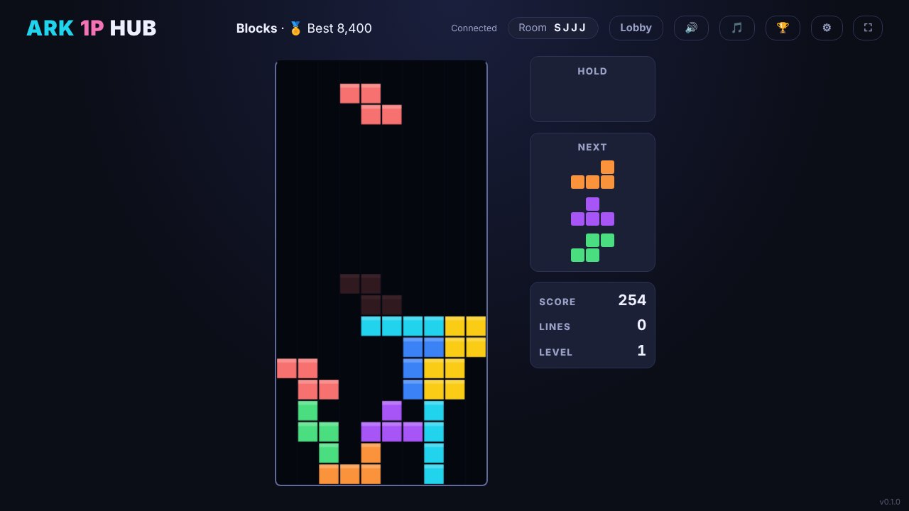 **Blocks** | 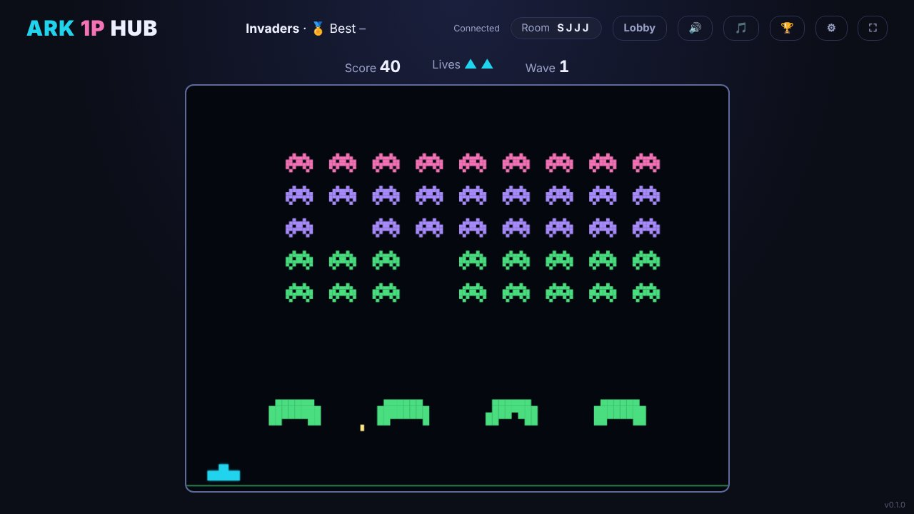 **Invaders** | 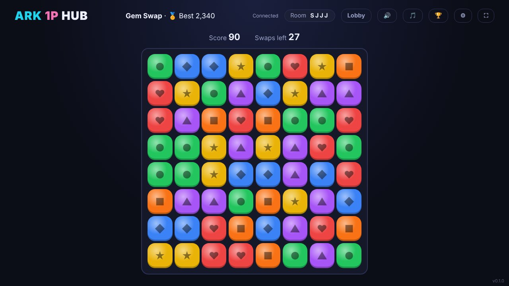 **Gem Swap** |
| 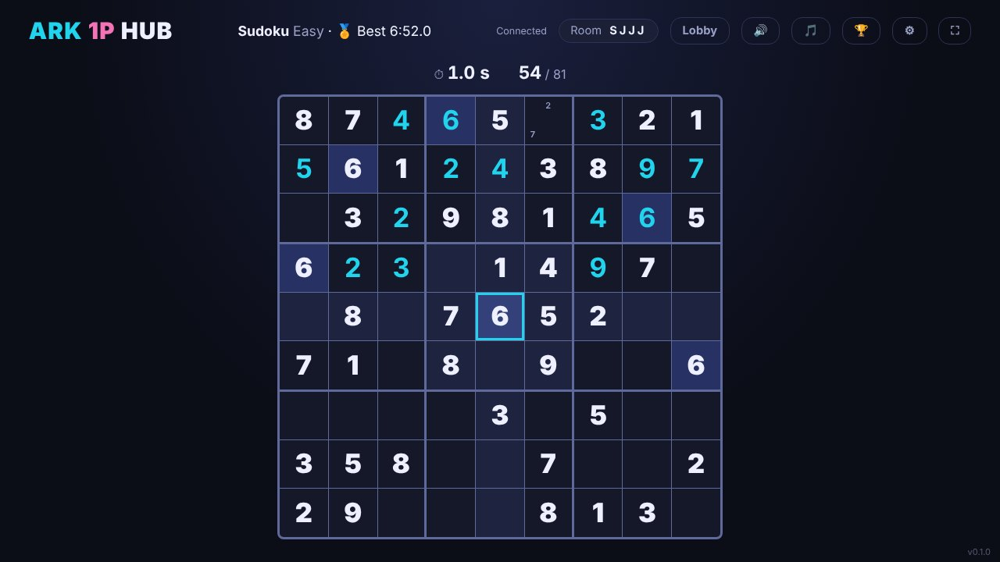 **Sudoku** | 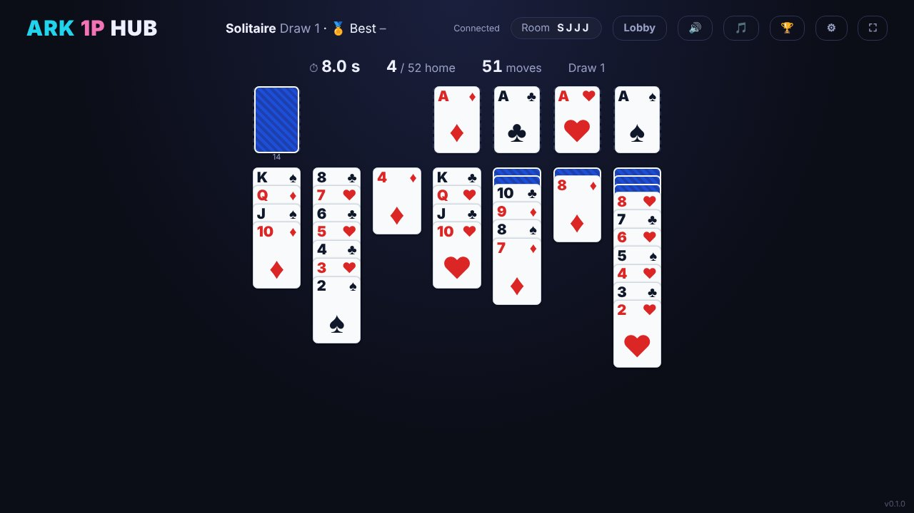 **Solitaire** | 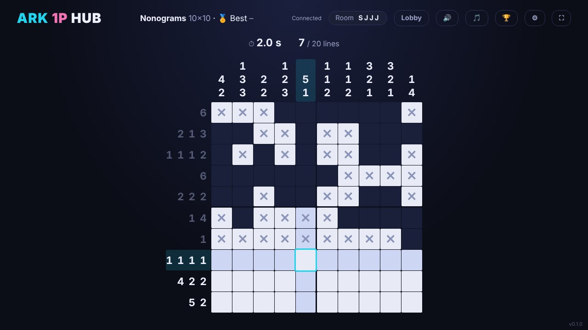 **Nonograms** |
| 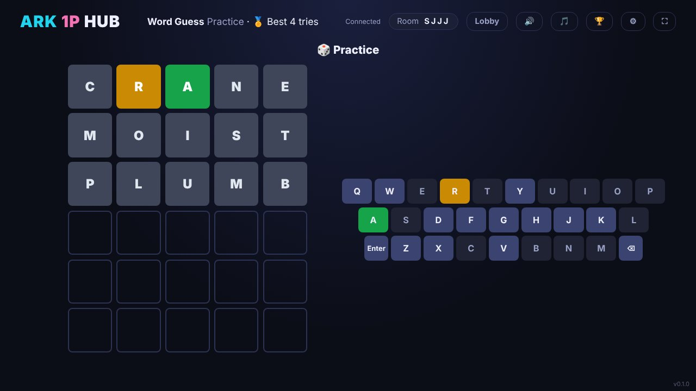 **Word Guess** | 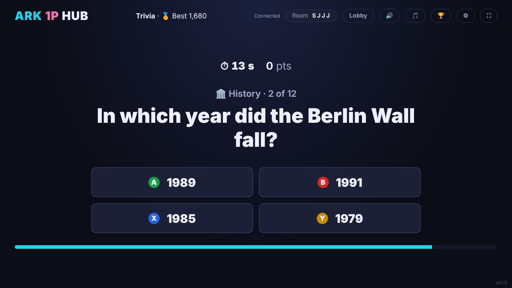 **Trivia** | 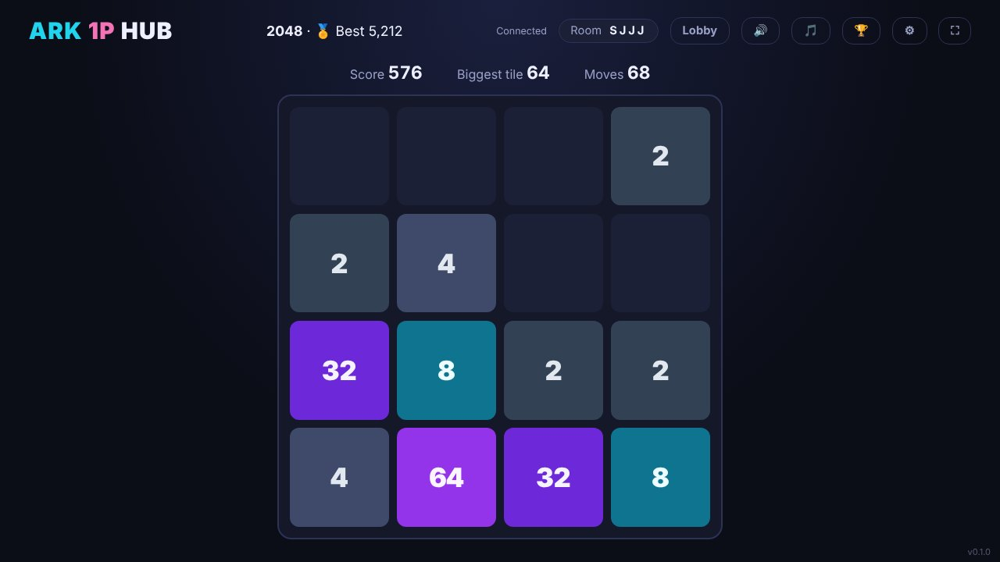 **2048** |
| 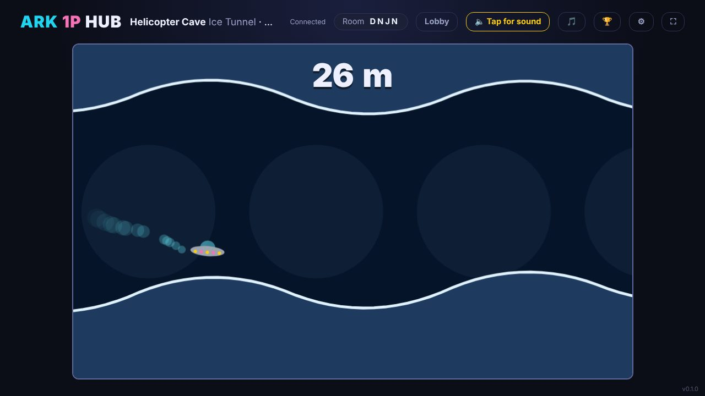 **Helicopter Cave** | 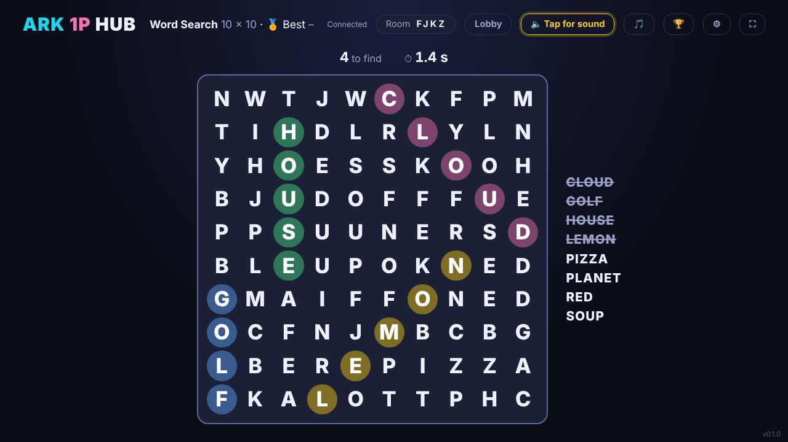 **Word Search** | 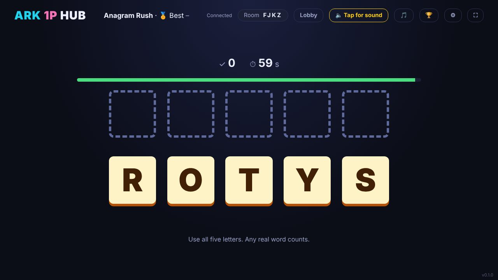 **Anagram Rush** |
| 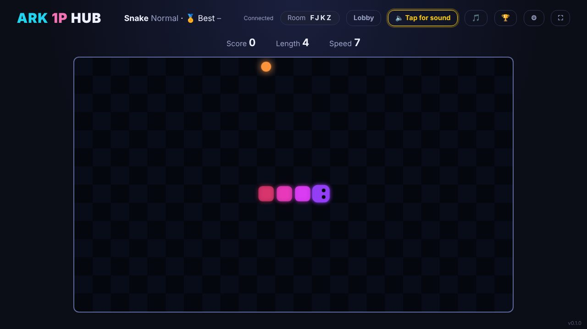 **Snake** 🌈 unlocked look | 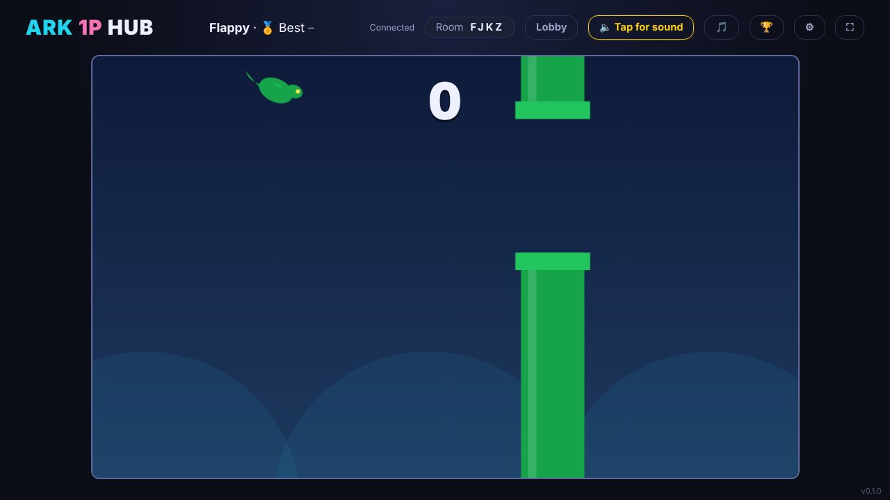 **Flappy** 🐉 unlocked look | 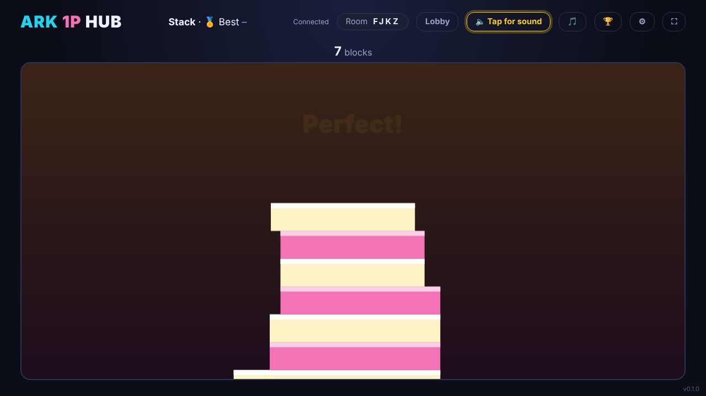 **Stack** 🍬 unlocked look |

The phone is the controller: each game gets its own (the Snake pad, Blocks' buttons, Trivia's answers),
and the TV page waits with a QR code until someone takes the seat.

| | | | |
| --- | --- | --- | --- |
| 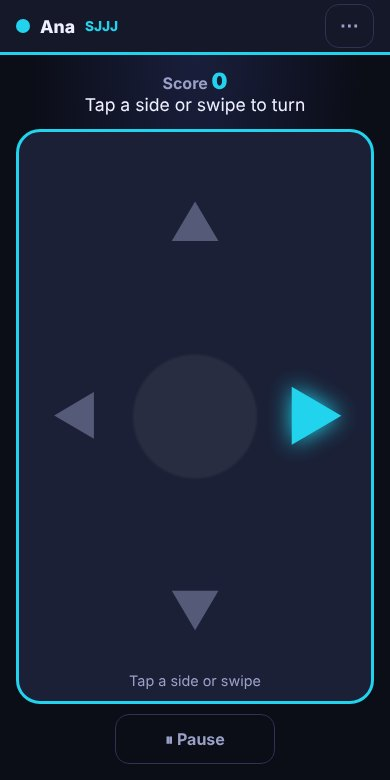 | 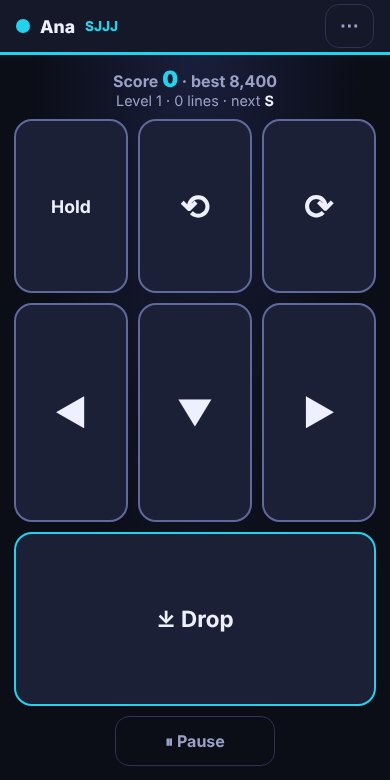 | 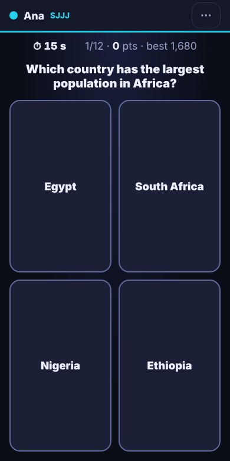 | 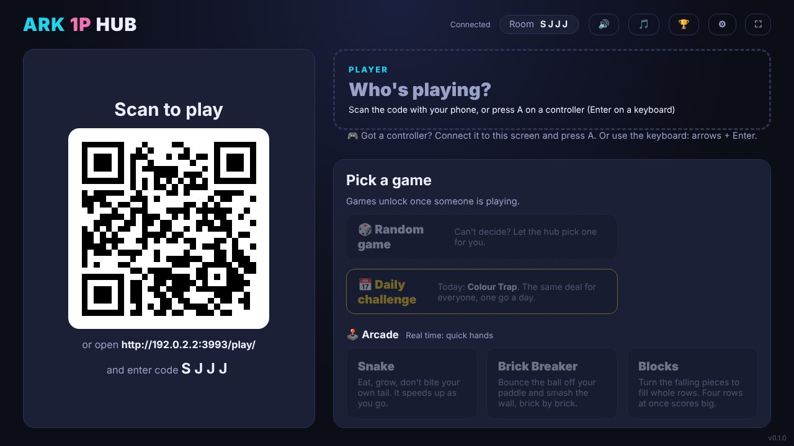 |

### 📅 Daily challenge

Next to Random game in the lobby: one game a day, **the same deal for everyone** (the same falling
pieces, the same board, the same questions), played at set settings. The lobby says which game it is
today. You get **one go a day** (it counts from the moment you start, so quitting doesn't give you
another), and each day's runs get their own high-score table, so you can see who did best with the
same luck. The games take turns, and every one comes round before any comes round again. A new
challenge at midnight (UTC).

## Controllers and the keyboard

The player can use a phone, **or** a game controller connected to the device
showing the TV screen (Xbox, PlayStation or most others, Bluetooth or USB),
**or** that device's keyboard. With no phone seated, press **A** (or **Enter**)
on the TV to play there.

| Where | Controller | Keyboard | Does |
| --- | --- | --- | --- |
| Lobby | **A** / **Start** | **Enter** / **Space** | Take the seat (as "Controller 1" or "Keyboard"), then start the picked game |
| Lobby | **D-pad** / stick | **Arrows** / **WASD** | Pick a game |
| Lobby | **Y** | **E** | Change your name: cycles through the names on the high-score table (so your scores count for you), then ready-made ones (Ace, Blaze, Comet…) |
| Lobby | **X** | **Q** | Pick your avatar and colour (D-pad to move, **A** to pick, **B** to close) |
| Lobby (desktop app) | **RT** | **U** | Press the **Update** banner when a new version is out |
| Lobby | **B** | **Backspace** | Leave the seat |
| Setup screen | **↑↓** row, **←→** change, **A** start | Arrows, **Enter** | |
| Any game | **Back / Select** | **Esc** | Back to the lobby |
| Game over | **A** play again · **Y** change settings · **B** lobby | **Enter** · **E** · **Backspace** | |
| Snake | **D-pad** / stick (or **Y**↑ **A**↓ **X**← **B**→), **Start** pauses | Arrows, **P** pauses | Turn |
| Brick Breaker | Stick or **D-pad ← →**, **A** launches, **Start** pauses | Arrows, **Enter**, **P** | Move the paddle |
| Blocks | **D-pad ← →** move, **↓** soft drop, **↑** / **RT** drop, **A** / **X** turn ⟳, **B** turn ⟲, **Y** / **LB** / **RB** hold, **Start** pauses | Arrows, **Enter** ⟳, **Backspace** ⟲, **E** hold, **P** | Held directions repeat |
| Flappy | **A**, **↑** or any face button, bumper or trigger; **Start** pauses | **Space**, **Enter** or **↑**; **P** | Flap |
| Asteroids | Stick / **D-pad ← →** turn, **↑**, **B** or **RT** thrust, **A** / **X** fire, **Start** pauses | Arrows (↑ thrust), **Enter** / **Space** fire, **P** | |
| Invaders | Stick / **D-pad ← →** move, **A** / **X** / **RT** fire, **Start** pauses | Arrows, **Enter** / **Space**, **P** | |
| Runner | **A** / **↑** (or any face button) jump, hold for higher; **↓** / **LT** / **LB** duck; **Start** pauses | **↑** / **Space** jump, **↓** duck, **P** | |
| Stack | **A** (or any face button, bumper or trigger) drops, **Start** pauses | **Space** / **Enter**, **P** | |
| Helicopter Cave | Hold **A**, **↑** (or any face button, bumper or trigger) to climb; **Start** pauses | Hold **Space**, **Enter** or **↑**; **P** | Climb |
| Bubble Shooter | Hold **←** / **→** (or the stick) to aim, **A** / **RT** / **↑** fires | Hold arrows to aim, **Space** / **Enter** / **↑** fires | |
| Road Hopper | **D-pad** / arrows hop, **Start** pauses | Arrows, **P** | |
| 2048 | **D-pad** / stick | Arrows | Slide |
| Minesweeper | **D-pad** moves a cursor on the TV, **A** opens, **X** / **B** flags | Arrows, **Enter**, **Q** / **Backspace** | |
| Sudoku | **D-pad** moves, **A** places the pen number, **X** / **Y** change it, **B** clears, **Start** pauses | Arrows, type **1**–**9**, **0** / **Backspace** clears, **P** | |
| Solitaire | **D-pad** moves (↑ from a column goes to the top row), **A** picks up / puts down (on the stock: turn a card), **X** sends it where it fits, **B** drops it, **Y** undo, **Start** finish | Arrows, **Enter**, **Q**, **Backspace**, **E**, **P** | |
| FreeCell | **D-pad** moves (↑ from the top of a column goes to the cells and foundations), **A** picks up / puts down, **X** sends it where it fits, **B** drops it, **Y** undo, **Start** finish | Arrows, **Enter**, **Q**, **Backspace**, **E**, **P** | |
| Mahjong Solitaire | **D-pad** moves between tiles, **A** picks, **X** hint, **Y** undo, **LB** / **RB** shuffle, **Start** pauses | Arrows, **Enter**, **Q**, **E**, **P** | |
| Sliding Puzzle | **D-pad** / stick | Arrows | Slide a tile into the gap (from the side the arrow points away from) |
| Gem Swap | **D-pad** moves, **A** picks a gem, then a direction swaps it; **B** lets go | Arrows, **Enter**, **Backspace** | |
| Sokoban | **D-pad** walks (and pushes), **Y** / **B** undo, **X** starts the level again | Arrows, **E** / **Backspace** undo, **Q** restart | |
| Nonograms | **D-pad** moves, **A** fills, **X** / **B** crosses out (again to clear), **Start** pauses | Arrows, **Enter**, **Q** / **Backspace**, **P** | |
| KenKen | **D-pad** moves, **A** next number, **Y** the one before, **X** / **B** clear | Arrows, type the number, **Backspace** / **Delete** clear | |
| Lights Out | **D-pad** moves, **A** flips, **Y** starts again | Arrows, **Enter**, **E** | |
| Word Search | **D-pad** moves, **A** on a word's first letter then **A** on its last, **B** lets go | Arrows, **Enter**, **Backspace** | Drag from the first letter to the last |
| Word Guess | **D-pad** picks a key on the TV's keyboard, **A** types it, **B** deletes, **Start** / **X** enters | Just type: letters, **Backspace**, **Enter** | |
| Simon | **A** green, **B** red, **Y** yellow, **X** blue, or the **D-pad** by position (↑ green, → red, ← yellow, ↓ blue) | Arrows by position | |
| Memory Pairs | **D-pad** moves, **A** turns a card over | Arrows, **Enter** | |
| Reaction Rush | Any face button, bumper or trigger | **Enter** / **Space** | Tap |
| Quick Maths | **A**, **B**, **X**, **Y**: the answer next to that letter on the TV | **1**–**4** | |
| Colour Trap | The face button of that colour: **B** red, **X** blue, **A** green, **Y** yellow | **R**, **B**, **G**, **Y** (or **1**–**4**) | |
| Anagram Rush | **D-pad ← →** picks a letter, **A** uses it, **B** takes one back, **Y** skips | Just type the word, **Backspace**, **Tab** skips | |
| Number Memory | **← →** pick a digit, **A** types it, **B** deletes, **Start** / **X** done | Type the digits, **Backspace**, **Enter** | |
| Odd One Out | **D-pad** moves, **A** picks | Arrows, **Enter** | |
| Trivia | **A**, **B**, **X**, **Y**: the answer next to that letter on the TV | **1**–**4** | |

Buttons use Xbox names. On a PlayStation controller A = ✕, B = ○, X = □, Y = △.
Browsers only notice a controller after one of its buttons is pressed, so press
A once if the TV doesn't react. A phone can take the seat only when nobody is
playing; tap ✕ on the player card on the TV (then **Remove?**) to free it.

## Profiles

Every player has an **avatar** (a fox, a robot, a rocket…) and a **colour**. They show on the TV's
player card, on the phone (its header and buttons take your colour) and next to your name in the
high scores and achievements. Pick them on the phone (tap your avatar at the top, or ⋯ → 🎨 Avatar
and colour), or on the TV: click the avatar on the player card, or press **X** on a controller
(**Q** on the keyboard). Until you pick, your name gives you one of its own, the same every time.
They're kept per name in `profiles.json` in the data folder, so they survive updates.

## Sound and music

The TV plays sound effects (countdowns, bites, bricks, merges, Simon's notes, a
fanfare for a new best) and background music made up live (no audio files): a
laid-back tune in the lobby, chiptune for arcade games, calm music for puzzles.
Browsers only allow sound after someone interacts with the page, so the first
time the TV shows **🔈 Tap for sound**: click it, or press any key. 🔊 mutes,
🎵 turns the music off (both remembered on that TV).

## High scores

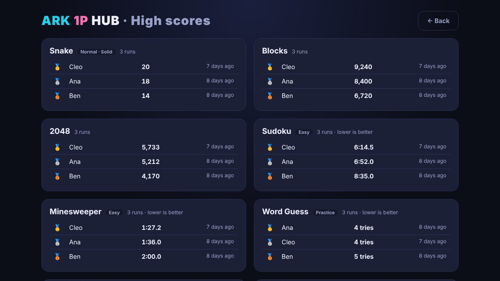

Every finished run is saved in `stats.json` in the data folder (so it survives
updates). The lobby shows your best in each game, and the TV shows the best to
beat while you play. The 🏆 button on the TV (and the link in the phone lobby)
opens `/stats/`: a top 10 for every game (and difficulty), the players, and the
latest runs. Players are matched by name (ignoring capitals), so use the same
name each time. A run that scores nothing, or a lost Minesweeper, isn't
recorded. Settings (`/admin/`) can clear all scores.

## Achievements

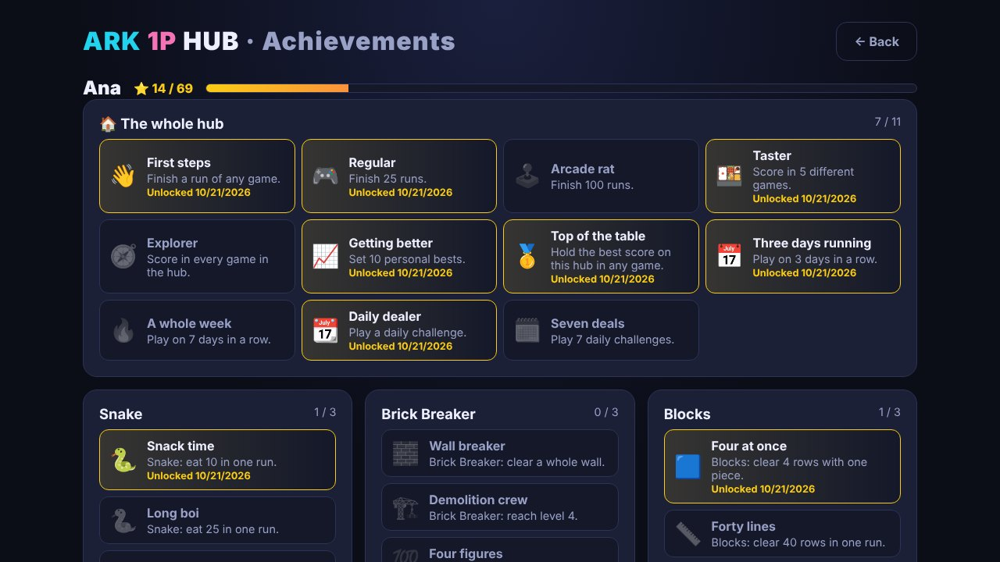

Goals to chase on your own: 114 of them, a few for every game (eat 25 in Snake, clear four rows at
once in Blocks, solve a Hard Sudoku, find the word in 3 guesses…) and some for the hub as a whole
(score in every game, set 10 personal bests, hold a top score, play 7 days in a row, play 7 daily challenges). They're
checked at the end of every run, and new ones pop up on the end screen on the TV and the phone.
The player card on the TV, each game's card and the phone lobby show how many you have; ⭐
**Achievements** (the phone lobby, the player card, or the ⭐ column in the high scores) lists
them all, done and to do. They're kept per player name with the scores (and cleared with them
in Settings). The list lives in `server/achievements.js`.

Some achievements also unlock things: Helicopter Cave's maps and vehicles, and new looks for
Snake, Brick Breaker, Flappy, Asteroids, Invaders, Runner and Stack. Locked choices show on the game's setup screen with what opens them
(🔒 *Eat 10 in one run to unlock*). Looks change only how a game looks, so they don't split the
scores; Helicopter Cave's maps each have their own. The looks live in `server/games/looks.js`.

## Secure page (https)

The hub answers both `http://` and `https://` on the same port. The certificate
is self-signed (made once and kept in the data folder), so each phone warns the
first time. None of the games so far need it (it's for future tilt and motion
games). Set `HTTPS=off` to serve plain http only.

## Quick start

### Desktop app (Steam Deck, Linux, Windows)

One app runs the hub and opens the TV screen full screen: an **AppImage** for the Steam Deck and
Linux (add it to Steam as a non-Steam game to launch it from Game Mode) and an **installer** for
Windows. No Docker needed. Download them from the repository's **Releases** page: GitHub builds
a new release every time a change is merged. The app updates itself: a new version shows an
**Update** banner in the lobby. Each release also has Steam library artwork. It uses port 3001, so it
can run next to Ark 2P Hub's app. See [desktop/README.md](desktop/README.md), and for the Deck the
step-by-step [Steam Deck guide](docs/STEAM-DECK.md).

### Docker (any machine on your network)

```bash
docker compose up -d --build
```

Then open `http://<server-ip>:3001/host/` in the TV's browser (a PC on HDMI, a
Google TV browser, or a Raspberry Pi). Your phone scans the QR code. The compose
file maps port **3001**, so it can run next to Ark 2P Hub (on 3000).

#### Fixing the QR code address

Inside Docker, the server only knows its own internal IP. If the TV page is
opened as `http://localhost:…`, the QR code can point somewhere phones can't
reach, and the TV shows a ⚠ warning. To fix it:

1. On a phone or PC, open `http://<server-ip>:3001/admin/` (or press ⚙ on the TV screen).
2. The first visit asks you to create an admin password.
3. Press **Use this page's address**, or type the address, then **Save**. The QR
   code on the TV updates right away.

The setting is stored in the `ark-data` Docker volume. You can also set
`ADMIN_PASSWORD` and/or `PUBLIC_URL` in `docker-compose.yml`; `PUBLIC_URL`
overrides the saved address.

### Update and redeploy from GitHub

Clone the repo once on the Docker machine, then run the update script from the
repo folder whenever there are bug fixes or new games:

```bash
git clone https://github.com/areyesromo/Ark-1p-Hub.git && cd Ark-1p-Hub

./update.sh                  # Linux / macOS / Pi
./update.sh --branch main    # switch to (and follow) another branch
./update.sh --force          # recreate the container even if nothing changed
./update.sh --port 3001      # where to check it's up (if you changed the port in docker-compose.yml)
```

```powershell
.\update.ps1                 # Windows (Docker Desktop), PowerShell 5.1 or 7
.\update.ps1 -Branch main
.\update.ps1 -Force
.\update.ps1 -Port 3001
```

It runs `git pull`, builds the image, redeploys with Docker Compose, then
checks `http://localhost:3001/version` and prints the version and commit that
are running. Details:

- **Failed build:** the running container is left as it is.
- **Pinned version:** if you've checked out a tag or commit to roll back, it
  won't pull.
- **Local changes:** they're kept, and the build is tagged `+dirty`.
- **Common git errors:** it explains them, including folders owned by another
  user ("dubious ownership") and ZIP downloads that aren't a git clone.
- **Screens:** after an update the TV and the phone reload by themselves, and
  the TV keeps its room code, so the phone reconnects without scanning again.
  (A run in progress does end, so update between games.) Scores and settings
  live in the `ark-data` volume and survive every update.

If Windows blocks the script, run `Set-ExecutionPolicy -Scope Process Bypass` first.

To update automatically, schedule it:

- **Linux (cron):** `*/10 * * * * /path/to/Ark-1p-Hub/update.sh >> /var/log/ark-update.log 2>&1`
- **Windows (Task Scheduler):** run `powershell.exe -NoProfile -ExecutionPolicy Bypass -File C:\path\to\Ark-1p-Hub\update.ps1` on a timer.

### Raspberry Pi 4/5 as a plug-in console

The Pi runs the server *and* shows the TV screen full-screen from boot, pairs
Bluetooth controllers and updates itself from GitHub (never mid-run; the TV
keeps its room code and your phone reconnects by itself). On Raspberry Pi OS
(64-bit, with desktop), as your normal user:

```bash
curl -fsSL https://raw.githubusercontent.com/areyesromo/Ark-1p-Hub/main/deploy/pi/install.sh | bash
sudo reboot
/opt/ark-1p/pair-controller.sh   # once per Bluetooth controller
```

It uses port **3001** and `/opt/ark-1p`, so it can share a Pi with Ark 2P Hub
(install one of them with `ARK_NO_KIOSK=1`, since only one can be the TV
screen). Full guide: [docs/raspberry-pi.md](docs/raspberry-pi.md).

### Local development

```bash
npm install
npm run dev        # restarts on file changes
npm test
```

Open <http://localhost:3000/host/> in one window and
<http://localhost:3000/play/> in another (or on your phone via your computer's
LAN IP), or just use the keyboard on the TV window.

## How it works

```
TV browser  /host  ◄──┐
                      ├── Socket.IO ──►  Node server (rooms + game logic + scores)
Phone       /play  ◄──┘
```

- **The server is the source of truth.** The phone only sends inputs
  (`{ type: 'turn', dir: 'up' }`); the server runs the game and pushes a *view*
  to the TV and the phone. A controller or the keyboard is read on the TV page,
  which sends its input for it.
- **Scores:** when a run ends, the room records it and adds your best and
  your rank to the end screen (see `server/stats.js`).
- **Reconnects are built in.** The phone keeps a seat token, so a locked
  screen, a refresh or a Wi-Fi blip drops you straight back in. The TV resumes
  its room after a refresh or a server restart too.
- **Room codes** are 4 letters; rooms are cleaned up after 30 idle minutes.

```
server/
  app.js, index.js        HTTP + Socket.IO setup
  sockets.js              the socket protocol (join, start game, input…)
  rooms.js                the room, its one seat, running a game, recording scores
  stats.js                runs, bests and high-score tables
  achievements.js         goals to chase, checked at the end of every run
  daily.js                the daily challenge: today's game and its seed
  profiles.js             each player's avatar and colour
  games/                  one file per game (pure logic, unit-tested)
public/
  host/                   TV page (and gamepads.js: controllers + keyboard)
  play/                   phone controller page
  games/<id>/host.js      how a game looks on the TV
  games/<id>/player.js    how a game looks and behaves on the phone
  stats/, admin/          high scores, settings
  achievements/           a player's achievements
deploy/pi/                Raspberry Pi installer, compose, kiosk, updater, controller pairing
desktop/                  the desktop app (Electron): AppImage for the Steam Deck / Linux, Windows installer
update.sh / update.ps1     pull from GitHub, rebuild and redeploy
```
